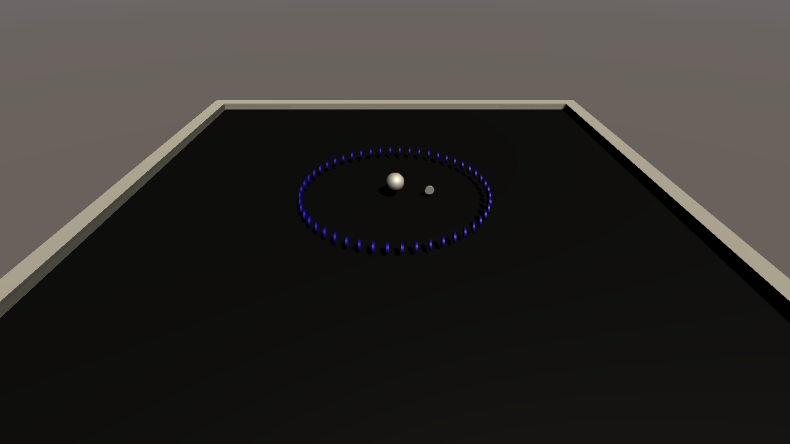

# CS464 Lab 05 · Mayasa Fakhar · BSCS23069

Roll-a-Ball from Lecture 06, with the three extra tasks. Open `Assets/Scenes/SampleScene.unity` and press Play. Move the ball with WASD or the arrow keys.

## The base game

- The ball is a Rigidbody and `PlayerController` pushes it with `AddForce` (speed 5).
- The arena is a 30 × 30 floor with a wall on each side.
- One gold coin is on the floor at a time. When I collect it, `Spawner` puts the next one at a random spot.
- `GameManager` keeps the score and a 60 second timer. If the time runs out it shows "Time's Up!".

## Task 1: one red coin

At the start `Spawner` picks a random number with `Random.Range(1, 11)`, so it is from 1 to 10. When the number of gold coins I've collected reaches it, the spawner puts down the red coin instead of a gold one. A `redCoinSpawned` bool makes sure it only happens once in a game.

## Task 2: 50 blue coins in a circle

When I collect the red coin, `Spawner.RedCoinCollected` places 50 blue coins in a circle with a 5 m radius around where the ball is. Each coin is 360 / 50 = 7.2° further round. If I'm close to a wall part of the circle would end up outside the arena, so I clamp the coins to 14 m from the centre, just inside the walls at 15 m.

## Task 3: hidden BonusCoins text

`BonusText` is under the Canvas and starts switched off. Collecting the red coin calls `BonusCoinUI.ShowBonusCounter`, which turns it on as "BonusCoins: 0/50". Every blue coin adds one, up to "BonusCoins: 50/50". After the last blue coin the gold coins start again.

## Winning

I win when I have at least 10 points, I have collected the red coin and I have collected all 50 blue coins. Then it shows "You Win!" and the game stops.
